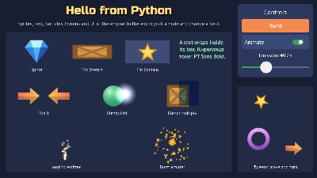

# The control API from Python

You will start `BagiDemo` from a Python script, let it run a few frames, read and change a node's text, press a button, take a picture and close the game. Then you will record the same session as a **scenario** file, give it a reference picture, play it green, change one word and see it fail with the picture that shows where. Last, two short sections: comparing renderers, and the server that lets a coding agent do the same.

You need the build from [Run the demo](run-the-demo.md) and Python 3.10 or later. The scripts use only the standard library: nothing is installed for the first two parts.

## What the control API is

A game started with a **control port** answers calls: a method name and some parameters, as JSON on a WebSocket on this machine (nothing else can connect: the server listens on `127.0.0.1` only). `step`, `screenshot`, `scene_get`, `ui_click` are such methods. `GameSession`, in `tools/control/bagi_session.py`, turns them into plain Python calls, so you never write the JSON. The editor's Activity panel lists who called what ([The editor](editor.md)).

The two scripts of this page live in `docs/guide/scripts/`. A test runs both on every `ctest`, so what you read here still works.

## Start it and look

<!-- source: docs/guide/scripts/drive_the_demo.py -->
```python
ENGINE_ROOT = Path(__file__).resolve().parents[3]
sys.path.insert(0, str(ENGINE_ROOT / "tools" / "control"))

from bagi_control_client import ControlError  # noqa: E402
from bagi_session import GameSession  # noqa: E402
...
    session = GameSession()
    try:
        session.launch(exe=str(exe))
        status = session.call("status")
        print("manual clock:", status["manualClock"], "frame:", status["frame"])
        assert status["manualClock"] and status["frame"] == 0
        print("frame", session.step(30, FRAME_SECONDS)["frame"])
```

`launch` starts the game with the control port on a free number, with **no window** and a **clock that stands still**: the game moves only when you call `step`. That is on purpose. A script and a test then get the same frames every time, whatever the speed of the machine. `step(30, 1 / 60)` runs 30 frames of one sixtieth of a second each and answers with the clock. `status` says whether the clock is manual, the frame it is at, the run mode (`Game` or `Editor`) and the size of the window.

## Read and write the scene

<!-- source: docs/guide/scripts/drive_the_demo.py -->
```python
        title = {"node": TITLE_NODE, "component": TITLE_COMPONENT, "path": "text"}
        print("title:", session.call("scene_get", title)["value"])
        session.call("scene_set", {**title, "value": NEW_TITLE})
        assert session.call("scene_get", title)["value"] == NEW_TITLE

        try:
            session.call("scene_set", {**title, "path": "nope", "value": 1})
            raise AssertionError("a write to a field that does not exist was accepted")
        except ControlError as error:
            print("refused:", error.code)
            assert error.code == "not_found"
```

A node is named by its path from the scene's root, `Text/Title`, and a component by its type, `TextComponent`. `path` is the field, written with the same name the file and the inspector use ([Config and reflection](config-and-reflection.md) follows one field through all of them). `scene_set` answers with what the field holds after the write.

A write the game refuses changes nothing and raises a `ControlError` whose `code` you can test: here `not_found`, because `TextComponent` has no field `nope`. A wrong type is `type_mismatch`, a number outside a field's range is `out_of_range`. The game's refusal is always a `ControlError`; a `SessionError` is the session's own (no game, a lost connection, a missing executable).

## Click and look

<!-- source: docs/guide/scripts/drive_the_demo.py -->
```python
        click = session.call("ui_click", {"name": "Burst"})
        print("click:", click["action"], click["takenBy"])
        assert (click["action"], click["takenBy"]) == ("DemoBurst", "element")
        session.step(1, FRAME_SECONDS)

        png, size = session.screenshot(max_size=PICTURE_SIZE)
        assert png.startswith(PNG_SIGNATURE)
        width, height = struct.unpack(">II", png[16:24])
        assert (width, height) == (size["width"], size["height"]) == (PICTURE_SIZE, PICTURE_SIZE * 9 // 16)
        with tempfile.TemporaryDirectory() as folder:
            picture = Path(folder) / "title.png"
            picture.write_bytes(png)
            print("picture:", picture.name, f"{width} x {height}")

        session.quit()  # the game's stdout is block-buffered: a Warning is in its log for sure only after it has exited
        problems = session.log_problems()
        print("log problems:", problems)
        assert problems == []
    finally:
        session.close()
```

`ui_click` presses the element called `Burst` the way a user would, and says what it sent: the action `DemoBurst`, taken by the element itself. [Input actions](input-actions.md) says what an action is and how to press a point of the scene with `click_at`. The game moves only on `step`, so the burst of sparks flies during the step that follows the click.

`screenshot` answers with a PNG, here at most 400 pixels on its longer side. The script checks it is a PNG of the size the answer says and then drops it, because the folder is temporary; this is what the same calls look like in a picture taken by the engine:



`log_problems` lists the Warning and Error lines the game wrote to its log, and a clean run has none. `close` is in a `finally` so that a failed assert does not leave the game running: it would keep its port and its process until you killed it.

The script printed, as run on this machine:

<!-- illustration: the output of drive_the_demo.py on the machine of the writer -->
```text
manual clock: True frame: 0
frame 30
title: BagiEngine demo scene
refused: not_found
click: DemoBurst element
picture: title.png 400 x 225
log problems: []
```

Run it yourself from the root of the repository:

<!-- command -->
```bash
python3 docs/guide/scripts/drive_the_demo.py
```

The game's path is its first argument and defaults to `build/macos-debug/bin/BagiDemo`.

## A game you started by hand

You can also talk to a game that is already running. Start the demo with the control port:

<!-- command -->
```bash
build/macos-debug/bin/BagiDemo --control
```

and connect to it. The port is `8765` unless you give `--control-port=N`; only a program on this machine can connect.

<!-- illustration: a one-off python3 -c that the writer ran against the game above; it is not in a file -->
```python
import sys, time
sys.path.insert(0, "tools/control")
from bagi_session import GameSession

session = GameSession()
try:
    info = session.connect()
    print("port", info["port"], "clock", "manual" if info["status"]["manualClock"] else "real")
    first = session.call("status")["frame"]
    time.sleep(1)
    print("the frame counter moved:", session.call("status")["frame"] > first)
finally:
    session.call("quit")
    session.close()
```

It printed:

<!-- illustration: the output of the script above on the machine of the writer -->
```text
port 8765 clock real
the frame counter moved: True
```

A game you started this way runs on the **real clock**: its frames come by themselves, so two reads a second apart see two different frames and a script cannot repeat a run exactly. That is why scripts and tests prefer `launch`. `close` only lets go of a game it did not start; the `quit` call above ends it.

## A scenario

A **scenario** is a session as a file: one JSON line per call, the header first. A player, `tools/control/bagi_play.py`, starts the game, sends the calls in order and checks what each answer was expected to be. It is a test you did not write by hand, because you recorded it by playing.

<!-- source: docs/guide/scripts/record_a_scenario.py -->
```python
    folder = Path(tempfile.mkdtemp(prefix="bagi-guide-"))
    print("folder:", folder.name)
...
    scenario = folder / "title.jsonl"
    session = GameSession()
    try:
        session.launch(exe=str(exe), record=str(scenario))
        session.call("scene_set", {"node": TITLE_NODE, "component": TITLE_COMPONENT, "path": "text", "value": SCENARIO_TITLE})
        session.step(2, FRAME_SECONDS)
        session.screenshot(max_size=PICTURE_SIZE)
        session.quit()
    finally:
        session.close()
```

`launch(record=...)` writes every call the game answered to the file when the session ends. The folder is a fresh temporary one on purpose: a recording refuses a folder inside a git work tree, so a script never leaves a file in a repository by accident. What it wrote:

<!-- illustration: the file the lines above record, as it is before the next step edits it -->
```json
{"scenario": 1, "game": "Demo", "flags": ["--headless", "--manual-clock"]}
{"method": "scene_set", "params": {"node": "Text/Title", "component": "TextComponent", "path": "text", "value": "Hello from a scenario"}}
{"method": "step", "params": {"frames": 2, "dt": 0.016666666666666666}}
{"method": "screenshot", "params": {"maxSize": 400}}
```

The header names the game and the flags it starts with, so the player starts it the same way. A recording writes only what the API promises, an error code and the steps of a version, and the demo has neither: until you add a `reference`, the file fails only when a call is refused. That is what lets a scenario survive a change of the scene's data.

Now the picture. The script adds a `reference` to the screenshot line, the PNG the player compares with:

<!-- source: docs/guide/scripts/record_a_scenario.py -->
```python
    lines = [json.loads(line) for line in scenario.read_text(encoding="utf-8").splitlines() if line.strip()]
    assert [line.get("method") for line in lines[1:]] == ["scene_set", "step", "screenshot"]
    lines[-1].setdefault("expect", {})["reference"] = REFERENCE
    scenario.write_text("".join(json.dumps(line) + "\n" for line in lines), encoding="utf-8")

    code, output = play(exe, scenario, "--update")
    show("update", code, output)
    assert code == EXIT_PASSED and (folder / REFERENCE["png"]).is_file()

    code, output = play(exe, scenario)
    show("play", code, output)
    assert code == EXIT_PASSED and "PASSED" in output

    scenario.write_text(scenario.read_text(encoding="utf-8").replace(SCENARIO_TITLE, CHANGED_TITLE), encoding="utf-8")
    code, output = play(exe, scenario)
    show("play after the change", code, output)
    assert code == EXIT_FAILED and ".actual.png" in output and ".diff.png" in output
```

The picture does not exist yet, so the first play uses `--update`: it plays the whole file, writes `references/title.png` next to it and keeps the line as it is. The second play compares the game's picture with that one and passes. The third has a different title text, so the picture differs and the play fails. The printed result of one run:

<!-- illustration: the output of record_a_scenario.py on the machine of the writer -->
```text
folder: bagi-guide-0186pt7i
update: exit 0
    created reference title.png
    UPDATED title.jsonl: 0 of 3 lines changed
play: exit 0
    PASSED title.jsonl: 3 calls
play after the change: exit 1
    FAILED title.jsonl:4  screenshot {"maxSize": 400}
      expected reference: references/title.png: at most 0% of the pixels changed by more than 0
      actual: 2.473% changed (2226 of 90000 px), box [39, 7, 262, 21]; actual picture: title.actual.png; difference map: title.diff.png
```

The failure names the line, the rule (a picture taken with `--update` has no tolerance: not one pixel may differ), how much changed and where (`box` is the rectangle of the changed pixels, a strip at the top of the picture where the title is), and two files: the picture the game made and a map of the difference. They go into a folder of their own in the system's temporary folder, `bagi-reference`, and never into a git work tree. A scenario of your own may allow a tolerance, `threshold` and `maxShare` in the `reference` line, for a picture that differs a little between machines.

Use `--update` when you changed the game on purpose and the new picture is the right one. The PNG and the lines it rewrites are files of your repository, so review them like code: a green test that was updated without a look proves nothing. The script keeps its temporary folder so you can open the files; `ctest` removes it.

<!-- command -->
```bash
python3 docs/guide/scripts/record_a_scenario.py
```

## Comparing renderers

`tools/control/bagi_backends.py` plays the calls of a scenario once per renderer that can take a picture, keeps each picture and diffs them against the first. It informs and does not fail (two renderers differ in anti-aliasing). On this machine:

<!-- illustration: the command and its output on the machine of the writer, the scenario being the one above -->
```text
$ python3 tools/control/bagi_backends.py build/macos-debug/bin/BagiDemo title.jsonl --out backends
software: 1 pictures in backends/software
window: not available: screenshot failed: capture_failed: this renderer backend cannot read its output back
1 backend available: there is nothing to compare (a missing backend is not a failure)
```

The `software` renderer of a headless game always works; a window renderer that cannot read its picture back is "not available", so there was nothing to compare here. The comparison needs a second renderer that can capture.

## For an agent: the MCP server

A coding agent can drive a game through the same calls, as an MCP server: `tools/control/bagi_mcp.py`. It is the only file here that needs a package (`mcp`), so it runs from the repository's virtual environment:

<!-- command -->
```bash
CI/setup_venv.sh
.venv/bin/pip install -r tools/control/requirements.txt
```

`CI/setup_venv.sh` needs `uv` and makes `.venv`; the second line adds the `mcp` package to it.

and the agent is told where it is, once, with its own tool (the line is written for Claude Code; it edits that tool's configuration, so it is shown and not run here):

<!-- illustration: a command of the agent's tool, not of this repository; it changes the person's own configuration -->
```bash
claude mcp add bagi -- .venv/bin/python tools/control/bagi_mcp.py
```

The tools mirror the session's calls: `launch_game`, `step`, `screenshot`, `scene_get`, `scene_set`, `ui_click`, `quit` and the rest (36 in all, as the server lists them). `launch_game` starts the game headless on the manual clock, as `launch` does, so an agent calls `step` before a picture that should show an action. The by-name methods (`get_property`, `set_property` and their kin) have no tool of their own: a script calls them with `session.call`. A game in a browser page cannot listen, so it is reached through a small bridge, `tools/control/bagi_bridge.py`, which this page does not cover.

## What you did

You started the demo from a script on a clock that stands still, read and changed a node's text, saw the game refuse a write and read why, pressed a button, took a picture and closed the game in a `finally`. You connected to a game started by hand and saw why its clock makes it less repeatable. You recorded the session as a scenario, gave it a reference picture, played it green and then red, and read the two pictures a failure leaves.

Next: [Test a game](test-a-game.md), the same calls as a test of your own game.
