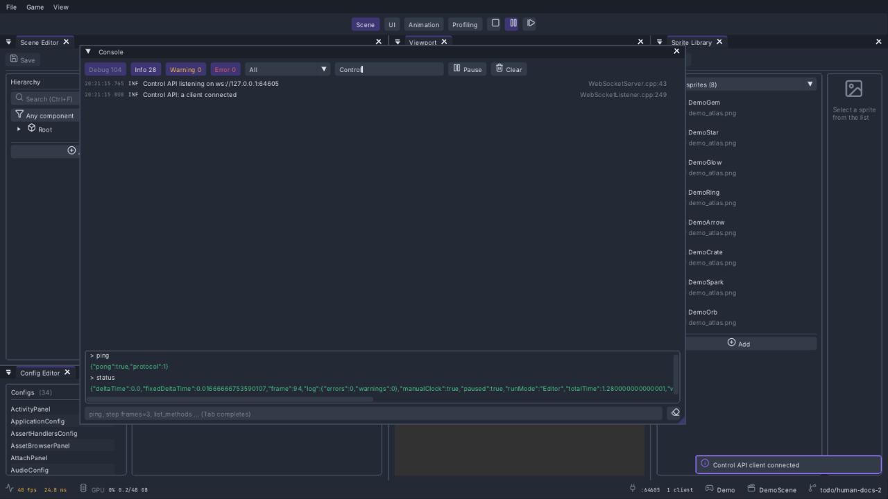

# The editor

[Run the demo](run-the-demo.md) opened the editor, changed one field and saved. This page goes through the rest of it: what each panel is for, one small task that uses four of them, the keys worth knowing, what a change does to the files, and how the editor differs in a browser. It takes about fifteen minutes.

Start, `--editor`, `Ctrl+Shift+E`, the hierarchy, the inspector, Save and `--content-overlay` are on that page and are not repeated here. Start the editor the way its section 6 does, with an overlay, so that nothing you do on this page touches the repository:

<!-- command -->
```bash
build/macos-debug/bin/BagiDemo --editor --content-overlay=$HOME/bagi-scratch
```

## 1. What the editor is

The editor is the same engine with panels drawn over the scene. A panel is a window: drag its tab to dock it in another place or to pull it out as a floating window. The engine remembers the layout between runs, in a folder of your own (not in the repository), so what you move stays moved.

At the top of the window, next to the menus, four buttons switch **workspaces**: `Scene`, `UI`, `Animation` and `Profiling`. A workspace is a ready arrangement of panels, so you do not have to dock them by hand. `Scene`, the one you start in, holds the Scene Editor, the Config Editor, the Viewport and the Sprite Library. The `View` menu lists every panel, and `View > Reset to Defaults` brings the ready arrangement of the workspace back. `View > Save Layout As...` keeps your own under a name.

## 2. A tour of the panels

| Panel | Where | What it is for | What it writes |
|-------|-------|----------------|----------------|
| **Scene Editor** | left, with the hierarchy and the inspector | the tree of the scene and the components of the picked node | the `<scene>` of `SceneConfig.xml`, on Save |
| **Viewport** | middle | the scene as the game draws it; its own toolbar for the size of the picture, the move, rotate and scale handles and where a click goes | nothing |
| **Config Editor** | bottom left | any config the engine has loaded, as typed fields, or as its XML tree when the engine has no type for it | that config's own file, on Save |
| **Sprite Library** | right | the sprites of the game: name, texture, the rectangle of the texture each one uses | the game's sprite library, on Save |
| **Asset Browser** | hidden; docked in the `UI` and `Animation` workspaces | the content files as folders and a grid of pictures, with a search and a filter by kind | nothing; it can also rename and delete a file |
| **Console** | hidden; `Ctrl+Shift+L` | the log, with filters, and a command line | nothing |
| **Game** | hidden; `Ctrl+Shift+G` | the state, the actions and the fields that the running game offers | nothing |

The Asset Browser is also the place to drag a file onto the viewport: that adds a node made from it. The Game panel shows what a game marks for it (`BE_REFLECT_FIELD`, `BE_FUNCTION`), and the demo marks nothing, so there it says `Demo (not controllable)` with a Reset button and an empty list of fields.

There are more windows, and each is one menu item away: the Profiler (`Ctrl+Shift+P`), Pool Strings (the engine's table of names), File changes, Field Help (the texts of the tooltips), Activity (who is talking to the control API), Generate (pictures and sounds from an art service), Export, Attach (to another running game) and Preferences (`Ctrl+,`). Each has a `CLAUDE.md` next to its code, in `src/Widgets/`, for the exact rules.

## 3. A small task: make the fountain stronger

The demo's fountain of sparks makes 40 sparks a second. You will raise it, look at what the engine says, find the sprite it draws, and save.

1. **Find the node.** In the hierarchy open `Root`, then `Particles`, and click `Fountain`. The inspector shows two components: `TransformComponent` and `ParticleEmitterComponent`.
2. **Open the emitter.** Click the arrow of `ParticleEmitterComponent`, then the arrow of `effect`. The fields of the effect are rows: `looping`, `rate` (40), `burstCount`, `maxParticles` and so on. Scroll down: `spriteId` says which sprite each spark is.
3. **Change a number.** Double-click `rate`, type `120` and press Enter. The Scene Editor shows `(unsaved changes)` next to Save, and look at the panel in the scene: its slider now reads `Emission: 120 /s`. The slider did not change by itself. The demo's panel reads the emitter every frame and shows what it finds, which is the point of [the page on input actions](input-actions.md): a widget holds no state of its own.
4. **See it move.** The viewport shows a `Paused` mark: the game is held. The pause button of the toolbar (`F6`) lets it run and `F7` steps one frame while it is held; the fountain at the bottom of the scene should spray more. (Not observed: the headless run that this page was written from holds the clock itself, so these two buttons and the thicker spray are read from their tooltips and the code. `Play` and `Stop` change a state of the toolbar only: the editor's game already runs, and the button's tooltip says so.)
5. **Find the sprite.** In the Sprite Library click `DemoSpark`, the sprite of step 2. The form beside the list shows its texture, a preview of the texture with the sprite's rectangle in green, and the numbers of that rectangle. This panel and the inspector are two views of two files: the inspector edits the scene, the library edits what a sprite id means.
6. **Open the Console.** Press `Ctrl+Shift+L` (`Cmd+Shift+L` on a Mac). A window with the log opens over the editor. The four toggles at its top filter by level, the combo by category, and the box by text: type `Control` and two lines are left, the control port and the client that connected. At the foot is a command line that runs a method of the control API: type `ping` and Enter, then `status`.

   

   The same Console is how you read what the engine did: the lines of the log have the file and the line of the code that wrote them, on the right.
7. **Ask what is unsaved.** Type `editor_state` in the command line. It answers `"anyDirty":true`, and a row for the scene says `"dirty":true`: that row is the same flag as the words next to Save.
8. **Save.** Press `Ctrl+S` (`Cmd+S` on a Mac), or click Save. A note `Scene saved` appears, and the Console has a line `Saved config 'SceneConfig' to ...`, with the path of the file it wrote, which is in your overlay. Type `editor_state` once more: `"anyDirty":false`.
9. **Check the file.** `$HOME/bagi-scratch/config/SceneConfig.xml` has `rate="120"` on the fountain's effect, and `git status` shows nothing. Delete the folder to start from the demo again.

When it is done: the Hierarchy, the Inspector, the Sprite Library and the Console each showed one thing of the same node, and only the Scene Editor wrote a file.

## 4. Commands and hotkeys

Everything the editor can do is a **command**: a menu item, a button, a key and an entry of the palette all send the same one. Press `Ctrl+P` (`Cmd+P` on a Mac) for the **command palette**: type a few letters of what you want, Enter runs it, and the chord of each command is written beside it. `Ctrl+,` opens Preferences, whose second tab lists every hotkey and lets you rebind it.

The chords worth knowing:

| Chord | Does |
|-------|------|
| `Ctrl+Shift+E` | switch the game and the editor ([Run the demo](run-the-demo.md), section 2) |
| `Ctrl+S` | save the scene |
| `Ctrl+Shift+S` | save the config open in the Config Editor |
| `Ctrl+P` | the command palette |
| `Ctrl+Shift+L`, `Ctrl+Shift+G`, `Ctrl+Shift+P` | the Console, the Game panel, the Profiler |
| `F6`, `F7` | pause or resume the game, step one frame |
| `F8` | where a click on the viewport goes: `Edit` keeps it for the editor, `Play` sends it to the game |
| `Alt+Left`, `Alt+Right` | the previous and the next node you selected |

On a Mac, `Ctrl` in this table is `Cmd`, except in `Ctrl+Shift+E` and `Ctrl+Shift+P`, which are the real Ctrl key. A hotkey needs `Ctrl` or `Alt`, or is an F key, so typing in a text field never runs a command. In the hierarchy, `F2` renames the node, `Delete` deletes it, `Ctrl+D` duplicates it and `Ctrl+F` goes to the search; in the viewport (Edit mode) `W`, `E` and `R` pick the move, rotate and scale handles and `F` frames the selection.

The `Edit` and `Play` of the viewport matter when you click on it: in `Edit` a click picks the node under it, in `Play` the game gets the click as a window would give it (for example the demo's `Burst` button). Hold `Alt` to use the other one for a single click.

## 5. What a change does

- **A scene change** (the inspector, the hierarchy, the handles of the viewport) is live at once and is **not on disk** until Save. Save writes the whole scene again in its normalised form ([Run the demo](run-the-demo.md), section 5).
- **A config change** in the Config Editor is kept in the panel until its Save. Save writes only what you changed into the loaded document, so the comments and the values you did not touch stay as they were. If the file changes on disk under it, the panel drops your unsaved edits and says `changed on disk`; [Config and reflection](config-and-reflection.md) tells how the engine reloads a config.
- **A file changed by another program** (your text editor, git) is noticed by the engine on a desktop, which watches the content folders. The File changes window (`View` menu) has a Rescan button: it lists the files that differ from what the engine knows, and Apply all takes them.
- **The Sprite Library** has a Save of its own.
- The three Saves (the scene, the open config, the library) each have a flag of their own, and `editor_state` lists them.

## 6. In a browser

The same editor runs in a web page when the game is built for it with the editor ([the web build](web-build.md) tells how the page is made). The live demo that the [README](../../README.md) links is the game, and the editor is a build of its own.

What is different. The writer built the page (`web-editor`) and drove it in a headless Chromium on a Mac, so the first four lines are seen; the rest is read from the code and its notes (`src/Widgets/EditorLayout/CLAUDE.md`, "The editor in a browser") and **not observed**.

- **A notice opens with the page**: a window says `Nothing you change here is kept: a reload brings back the content the page came with`, with an OK button. Seen.
- **Where an edit lives.** The page has a file system in memory. Seen: a node added in the hierarchy made the Scene Editor say `(unsaved changes)`; the Save button wrote `Scene saved` and cleared it; after a reload the node was gone. Nothing in the docs offers a download, so to keep a change from a browser you copy it out by hand. The editor's own layout and preferences live in the same memory.
- **The game runs live.** Seen: there is no `Paused` mark on the viewport and the tweens move, so you can watch an edit work without pressing anything.
- **The same panels** of the `Scene` workspace, in a page 1600 pixels wide. Seen: the Scene Editor is narrow there and its Inspector is cut off at the right; drag the border between the panels to give it room.
- **Hidden:** Generate, Export, File changes and the Profiler's Chrome trace, because each needs a program or a folder that a page does not have. Attach is hidden as well: a page opens no link to another program. Preferences has no "Open files with".
- **The keys.** `Ctrl` or `Cmd` with `S`, `P`, `,` and the other chords of the table above work, and the page stops the browser's own reaction to them (so `Cmd+S` does not open the browser's save dialog). On a Mac page `Cmd` is the editor's `Ctrl`: in the run, a press of `Control+S` did nothing, and the Save button worked. `Ctrl+C`, `V` and `X` are left to the browser, because it allows the clipboard only after a gesture of yours. `Ctrl+W`, `T`, `N` and `Q` belong to the browser and cannot be hotkeys.
- **File > Quit** ends the game and leaves the page stopped until you reload it. A phone is not a target.

## What you did

You looked at what each panel is for, changed a number in one panel and found the effect in two others, saved, and asked the engine what was unsaved. You know where the chords are and what a change does before Save and after it.

Next: [The web build](web-build.md) builds the demo for a browser and serves it on your machine.
