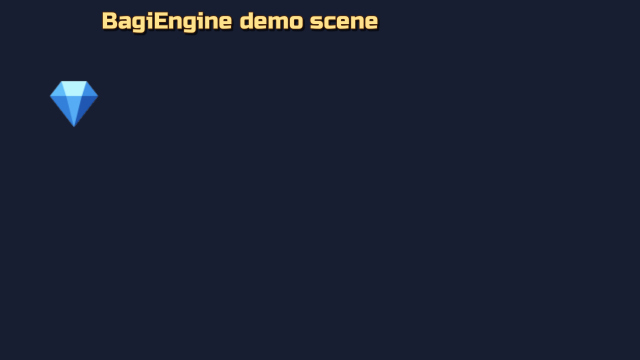

# Your first scene

You will write a scene file by hand, from an empty one to a scene with a background, a title and a sprite, and run it. Every block below is an excerpt of the finished scene, `docs/guide/examples/first-scene/config/SceneConfig.xml`, so you can open that file next to this page and find the same lines. Its nodes are the demo's own: the demo's `tools/demo/config/SceneConfig.xml` is the bigger scene they are cut from.

You need the build from [Run the demo](run-the-demo.md). No C++ is written here: a scene is data.

## Where the file goes

A scene lives in `config/SceneConfig.xml`. The engine has one, and every game can have its own: a game's file of the same name replaces the engine's whole file, it is not merged. (A game of your own: [NEW_GAME.md](../../NEW_GAME.md).)

To try a scene without a game of your own, give the demo a folder that holds your file. It is read before the demo's own, as a game's file would be:

<!-- command -->
```bash
mkdir -p $HOME/bagi-first-scene/config
build/macos-debug/bin/BagiDemo --content-overlay=$HOME/bagi-first-scene
```

Until your file exists, the demo shows its own scene. As soon as `$HOME/bagi-first-scene/config/SceneConfig.xml` exists, it wins. Run the second line again after each step below to see the step.

If a step went wrong and you want the finished scene, copy the example folder and run it:

<!-- command -->
```bash
cp -r docs/guide/examples/first-scene/config $HOME/bagi-first-scene/
build/macos-debug/bin/BagiDemo --content-overlay=$HOME/bagi-first-scene
```

## 1. An empty scene

Make `$HOME/bagi-first-scene/config/SceneConfig.xml`. Write the skeleton; where the excerpt has `...`, leave the space between `<nodes>` and `</nodes>` empty:

<!-- source: docs/guide/examples/first-scene/config/SceneConfig.xml -->
```xml
<?xml version="1.0"?>
<SceneManager contentVersion="6">
  <scenes>
...
    <scene type="Scene" name="DemoScene" viewWidth="1280" viewHeight="720">
      <nodes>
...
      </nodes>
    </scene>
  </scenes>
</SceneManager>
```

From `docs/guide/examples/first-scene/config/SceneConfig.xml`.

Run it. The window is plain dark grey: a scene with no nodes draws nothing.

What the lines say:

- `SceneManager` holds the scenes of the game. The first one is active when the game starts; the game then asks for a scene by name, and the demo asks for `DemoScene`.
- `contentVersion` is the version of the format of content files. Copy the number from the demo's file; when the format changes, a tool in `tools/migrate/` brings a game's files up to date.
- `viewWidth` and `viewHeight` give the scene its own size in view units. Every position and size below is in these units, and the engine scales the whole view to the window. So the scene looks the same in a small and in a large window.
- `name` identifies the scene. Keep `DemoScene` for the demo: with another name the log says `SceneManager: scene 'DemoScene' not found` (the scene still shows, as the first one). A game names its scene in its own `IGame`.

## 2. A background

A node is a named thing in the scene with components on it. A component is data: this one says where the node is, that one says how it is drawn. Put this node between `<nodes>` and `</nodes>`:

<!-- source: docs/guide/examples/first-scene/config/SceneConfig.xml -->
```xml
<node name="Sky" layer="-1">
  <components>
    <component type="TransformComponent" x="0" y="0" width="1280" height="720" />
    <component type="QuadRendererComponent">
      <color r="24" g="30" b="50" a="255" />
    </component>
  </components>
</node>
```

From `docs/guide/examples/first-scene/config/SceneConfig.xml`. (In the demo's file it sits inside a group node called `Background`; here it goes straight into `<nodes>`.)

Run it: the window is a dark blue now.

- `TransformComponent` is the rectangle of the node: `x`, `y` is the top left corner, then `width` and `height`, in view units. This one covers the whole 1280 by 720 view.
- `QuadRendererComponent` fills that rectangle with `color`: red, green, blue and alpha (opacity), each from 0 to 255.
- `layer` orders drawing. A lower layer is drawn first, and the default is 0. A node with no layer that comes later in the file draws on top of an earlier one, so a background gets a lower layer to stay behind whatever you add, wherever it stands in the file.

To see why, cut the `Sky` node, paste it after the last node you will write in step 4, and delete `layer="-1"`: the sky now covers everything. Put the layer back and it goes behind again.

## 3. A title

Add this node after `Sky`:

<!-- source: docs/guide/examples/first-scene/config/SceneConfig.xml -->
```xml
<node name="Title">
  <components>
    <component type="TransformComponent" x="24" y="14" width="912" height="62" />
    <component type="TextComponent" text="BagiEngine demo scene" fontFamily="Russo One" fontSize="46" align="Center" wrap="false" overflow="AutoFit" outlineWidth="2" shadowOffsetX="3" shadowOffsetY="4">
      <color r="255" g="226" b="140" a="255" />
      <outlineColor r="90" g="45" b="10" a="255" />
      <shadowColor r="0" g="0" b="0" a="150" />
    </component>
  </components>
</node>
```

From `docs/guide/examples/first-scene/config/SceneConfig.xml`.

Run it: a yellow title with a dark outline and a shadow appears at the top.

- The text is drawn inside the rectangle of the node's `TransformComponent`, so the box decides where it sits: `align="Center"` centres the line inside the 912 units of the box.
- `text` is what is written, `fontSize` is the height in view units and `color` is the colour of the letters. `fontFamily` picks a font by the name the engine knows; leave it out and you get the default font (PT Sans).
- `wrap="false"` keeps the text on one line, and `overflow="AutoFit"` makes it smaller when it does not fit the box.
- `outlineWidth`, `outlineColor`, `shadowOffsetX`, `shadowOffsetY` and `shadowColor` are decoration. Delete them and the title is plain.

## 4. A sprite

A sprite is a part of a picture that has a name:

<!-- source: docs/guide/examples/first-scene/config/SceneConfig.xml -->
```xml
<node name="Gem">
  <components>
    <component type="TransformComponent" x="88" y="150" width="120" height="112" />
    <component type="SpriteRendererComponent" spriteId="DemoGem" fit="Contain" />
  </components>
</node>
```

From `docs/guide/examples/first-scene/config/SceneConfig.xml`. Add it after `Title` and run: a blue gem appears at the left.

`spriteId` is not a file name. It is the name of an entry of the sprite library, the file `TextureLibrary.xml` in `config/`, which says which picture the sprite is cut from and which rectangle of it. The demo's entry for this one:

<!-- source: tools/demo/config/TextureLibrary.xml -->
```xml
<sprite name="DemoGem" texturePath="assets/textures/demo_atlas.png">
  <srcRect x="0" y="0" w="64" h="64" />
</sprite>
```

From `tools/demo/config/TextureLibrary.xml`. A game keeps its own `TextureLibrary.xml` for its pictures; an id that is not in a library draws nothing.

`fit` says what to do when the picture and the box are not the same shape: `Contain` keeps the proportions of the picture and centres it in the box, `Stretch` (the default) fills the box.

The scene of the four steps, as the demo draws it:



## 5. When you make a mistake

The engine does not stop at a typo in a file; it starts and tells you in the log. Add `fontsize="46"` to the `TextComponent` of the title, next to the real `fontSize`, and run again. The terminal where you started the demo shows:

<!-- illustration: the warning the engine writes for an unknown attribute; the time of day is whenever you run it, the numbers show where the mistake is (scenes[0], the second node, its second component) -->
```text
[Warning] [12:00:00.000] Config 'SceneConfig': scenes[0].nodes[1].components[1].fontsize: Unknown attribute 'fontsize', did you mean 'fontSize'?
```

Read it from the left: the level (`Warning`), the time of day (the second bracket; yours differs), the file (`SceneConfig`), the path to the place (the first scene, the second node, the second component) and the attribute. The title looks the same, because the engine did not know the key and skipped it. Start with `--strict-config` and the same findings are written as errors.

## 6. See it in the editor

The same folder works for the editor:

<!-- command -->
```bash
build/macos-debug/bin/BagiDemo --editor --content-overlay=$HOME/bagi-first-scene
```

Open `Root` in the hierarchy of the Scene Editor tab: `Sky`, `Title` and `Gem` are there, in the order of the file. Click one and its components are in the inspector with the same names and values as in the XML. Change a value and press `Save`: the editor writes the scene back into your file in the folder, in its own normalised form (see [Run the demo](run-the-demo.md)), and the repository stays untouched.

## What you did

You wrote the data of a scene: nodes with a rectangle, and a quad, a text or a sprite on each. The layer sets the order, the view units make it independent of the window, and a game's own `config/` files replace the engine's of the same name.

Next: [A UI screen](ui-screen.md), which uses the same nodes for buttons and panels.
