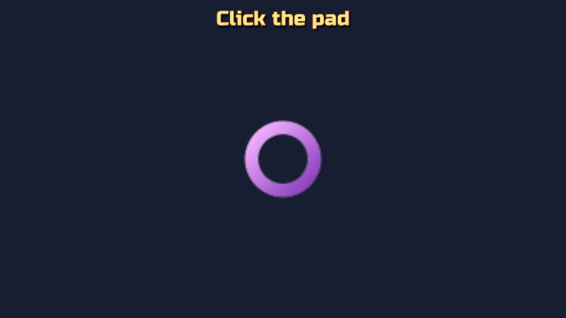
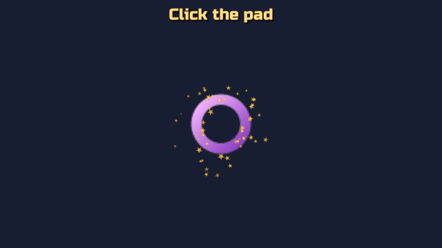

# Input actions

You will make a click do something with no C++: a round pad on a scene that, when pressed, sends the name `Pop`, and a burst of sparks that waits for that name. Then you will read the few lines of C++ that listen to the same name, and press the pad from a Python script. Every block below is an excerpt of a real file: the example folder `docs/guide/examples/input-actions/`, the demo's own source, or a file that a test runs.

You need the build from [Run the demo](run-the-demo.md) and the overlay folder of [Your first scene](first-scene.md). The first half is data.

## What an action is

An **action** is a name. A press, a toggle or a slider sends it; whoever wants it listens for it. The sender knows nobody, and the listener knows no sender. That is the point: a button on the screen, a click on a node and a script can all make the same thing happen, because they all send the same name, and a screen holds no game state of its own, since it only says "the player asked for `Pop`" and the game decides what that means.

The name travels as an `InputEvents::ActionEvent`, with two texts: the `action` and a `value` (empty for a plain press; a toggle sends `on` or `off`, a slider the number under the pointer, a choice the option picked).

## Make a click do something without C++

Copy the example into a folder of your own and give that folder to the demo:

<!-- command -->
```bash
mkdir -p $HOME/bagi-input
cp -r docs/guide/examples/input-actions/config $HOME/bagi-input/
build/macos-debug/bin/BagiDemo --content-overlay=$HOME/bagi-input
```



(The pictures of this page are taken with `python3 tools/docs/guide_shots.py --only input-before,input-clicked`.) The ring is the pad. Click it: sparks fly out of it, once per click. A click beside the ring does nothing.



Two nodes make this, and they do not know each other. The pad is a node with a `ClickableComponent`; the emitter is a node with a `ParticleEmitterComponent`. They meet only in the name:

<!-- source: docs/guide/examples/input-actions/config/SceneConfig.xml -->
```xml
<component type="ClickableComponent" actionName="Pop" shape="Ellipse" />
...
<component type="ParticleEmitterComponent" playOnStart="false" burstAction="Pop">
```

`actionName` is what the pad sends when it is pressed, and `shape="Ellipse"` makes the round part of the ring the only part that takes the press (the default is the whole rect, corners included). `burstAction` is the name the emitter waits for: when it comes, the emitter fires its burst at the middle of its node. `playOnStart="false"` keeps it quiet until then. Change both words to `Boom` and it works the same; change only one and the click does nothing, and nothing says why, so check the two spellings first when a click does not answer.

Other components listen by name too: an `AudioSourceComponent` has a `playAction` that plays its clip. Give it the same name and the click makes a sound as well, with no change to the pad.

## What else sends an action

A `ClickableComponent` is for a node of the scene. A button, a toggle or a slider of a UI screen sends an action the same way, from its `action` field. The demo's panel has all three, in `tools/demo/config/SceneConfig.xml`:

<!-- source: tools/demo/config/SceneConfig.xml -->
```xml
<component type="UIInputClicker" action="DemoBurst" />
...
<component type="UIToggleComponent" bind="demoAnimate" action="DemoAnimate" />
...
<component type="UISliderComponent" bind="demoEmission" action="DemoEmission" minValue="0" maxValue="120" step="5" partShape="Round" />
```

The button sends `DemoBurst` with an empty value. The toggle sends `DemoAnimate` with `on` or `off`, the opposite of what it shows now. The slider sends `DemoEmission` with the number under the pointer, snapped to `step`. A group of choices (a row of segments, or a dropdown) sends one action and the `value` of the option picked.

A widget owns no state: it does not remember that the toggle is on. The game does, and it writes the answer into a variable (`bind` names it) that the widget reads. So the screen cannot disagree with the game: if the game refuses the change, the widget stays where it was. The demo's panel is the real case, and the next section shows its listener.

## The same in C++

A component listens in `OnAttached`, with one line, and the handler gets the event. This is the demo's `DemoControlsComponent`, the part of the demo that answers the toggle and the slider above:

<!-- source: tools/demo/src/Demo/Components/DemoControlsComponent.cpp -->
```cpp
SubscribeInScene<InputEvents::ActionEvent, &DemoControlsComponent::OnAction>(this);
...
void DemoControlsComponent::OnAction(const InputEvents::ActionEvent& e) {
    const StringView value = e.value.ToStringView();
    if (e.action == DemoNames::animateAction) {
        if (value == DemoNames::on || value == DemoNames::off) {
            CoreManager::GetUIVars().Set(DemoNames::animateVar, value);
        }
    } else if (e.action == DemoNames::emissionAction) {
        const Optional<float> rate = UIText::ParseFiniteFloat(value);
```

From `tools/demo/src/Demo/Components/DemoControlsComponent.cpp`; the engine's tests run it (`DemoControlsTest`, in `DemoTests`). The handler compares the action with a name it knows, checks the value (a toggle's text is only `on` or `off`, so anything else is dropped), and writes the answer into `UIVars`, which the toggle then shows. Names are `PoolString`s, so a compare is one number against another.

`SubscribeInScene` and a plain `Subscribe` differ in one thing: an action is a global event, and a plain `Subscribe` hears it even while the component's scene is not the active one. `SubscribeInScene` skips the call then. Use it unless you mean to listen from a scene that is asleep.

The event comes in the first stage of the frame (`src/Modules/BECore/CLAUDE.md`, "Frame order and time"), from the mouse the engine has just read. A handler changes state and does not draw: drawing runs later in the same frame and reads what you set. The emitter above works the same way; it is a listener like yours.

## Raw input

The action is not the first thing that happens. A mouse press first goes to the things that can take it, topmost first: a UI screen, then a `ClickableComponent`. The first that wants it consumes it, and only a press that nobody consumed reaches game code, as a raw mouse event (`SDLEvents::MouseButtonDownEvent`, in output pixels). So a click on a button does not also hit the board under it. A `ClickableComponent` with `blocksInput="true"` is a shield: it takes the press and sends nothing, to keep what is drawn below it from reacting.

A key is raw too. The engine has no table that binds a key to an action: a key arrives as `SDLEvents::KeyDownEvent`, and a game that wants "Escape closes the panel" subscribes to it and, if it likes, sends the `ActionEvent` itself, so that the rest of the game listens by name as before.

## Press it from a script

A script reaches the same door as the mouse. `click_at` presses a point, and takes the same path as a person's click: the pad takes it, and the action goes out. Start the demo on your copy with the manual clock, click on the pad and beside it, and look at what the game answers:

<!-- illustration: a script that exists in no file; it is the Python session of tools/control (the control API calls step, click_at and screenshot) -->
```python
import os
import sys

sys.path.insert(0, "tools/control")
from bagi_session import GameSession

session = GameSession()
try:
    session.launch(exe="build/macos-debug/bin/BagiDemo", content_overlay=os.path.expanduser("~/bagi-input"))
    session.step(5, 0.016)
    for x, y in ((640, 360), (200, 600)):
        reply = session.call("click_at", {"x": x, "y": y, "space": "scene"})
        print((x, y), "consumed:", reply["consumed"])
    session.step(40, 0.016)
    png, size = session.screenshot()
    with open(os.path.expanduser("~/bagi-input/after-click.png"), "wb") as file:
        file.write(png)
    print("picture", size["width"], "x", size["height"])
finally:
    session.close()
```

Run it from the root of the repository with `python3`, with the example unchanged in your copy. It prints:

<!-- illustration: what the script prints -->
```text
(640, 360) consumed: True
(200, 600) consumed: False
picture 1024 x 576
```

`space` is `scene` (the units of the scene file) or `output` (pixels of the window). `consumed` says whether something took the press: the pad did, the empty sky did not. The picture `after-click.png` in your folder has the sparks of the first click: the burst flies during the `step` that follows it, because the game moves only when you step it.

A UI element has a call of its own that needs no coordinates, `ui_click`, which presses an element by its name and answers with the action it sent. On the demo's panel:

<!-- illustration: a script that exists in no file; the same session on the demo itself, with no overlay -->
```python
import sys

sys.path.insert(0, "tools/control")
from bagi_session import GameSession

session = GameSession()
try:
    session.launch(exe="build/macos-debug/bin/BagiDemo")
    session.step(5, 0.016)
    reply = session.call("ui_click", {"name": "Burst"})
    print(reply["action"], repr(reply["value"]), reply["takenBy"])
    session.step(1, 0.016)
finally:
    session.close()
```

<!-- illustration: what the script prints -->
```text
DemoBurst '' element
```

`takenBy` says who took the press: `element` (the element itself), `target` (something drawn above it, a `ClickableComponent`, took it, and the element sent nothing) or `none`. The game's own `perform_action` is another thing: it is the call of a game that has registered its moves with the control API (the QA games of the engine), and it does not go through the mouse at all. For a scene or a screen, `click_at` and `ui_click` are the calls.

## What you did

You made a pad send a name and an emitter listen for it, in two nodes and two words, and saw that a press beside the pad sends nothing. You read what else sends a name (a button, a toggle, a slider, a choice), why a widget holds no state, how a component listens in C++, and where raw mouse and key events fit. You pressed the pad from a script.

Next: [A save](save-game.md), how a game writes what the player did to a file and reads it back.
