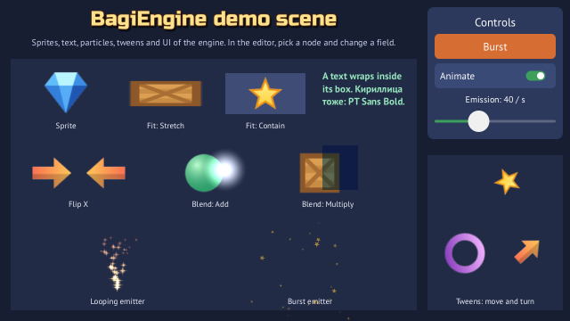
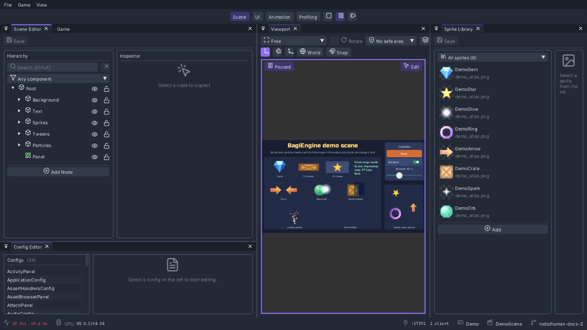

# Run the demo

You will run the engine's demo, open its editor, change one thing, save, and look at what the save wrote to disk. It takes about ten minutes once the build is done.

You need the build from the [README](../../README.md#build-it): after `cmake --build --preset macos-debug` the demo is a program in `build/macos-debug/bin/`. On Windows the same program is `build\windows-clang-debug\bin\BagiDemo.exe`, and the commands below change in the same way as in the README.

## 1. Start the game

Type this in the root of the repository:

<!-- command -->
```bash
build/macos-debug/bin/BagiDemo
```

A window opens with the demo scene: a title, a few sprites, two particle emitters, three shapes that move and a small panel at the top right.



Try the panel. `Burst` fires the second emitter once. `Animate` stops and starts the moving shapes. The `Emission` slider changes how many sparks the first emitter makes each second. The panel is part of the scene, not part of the window, so it is drawn by the engine in the same way as everything else.

Close the window to quit.

## 2. Open the editor

The same program has an editor in it. Start it in the editor from the first frame:

<!-- command -->
```bash
build/macos-debug/bin/BagiDemo --editor
```

Or press `Ctrl+Shift+E` in a running game to switch between the game and the editor. (A debug build has the editor. A release build may not: then `--editor` starts the game and writes one warning to the log.)



The three parts you need now:

- **Hierarchy** (top left, in the tab Scene Editor): the tree of the scene. `Root` is the top of it, and under it are the groups of the demo: `Background`, `Text`, `Sprites` and so on.
- **Viewport** (middle): the scene as the game draws it. It starts paused, so the shapes and sparks do not move until you press play in the toolbar at the top.
- **Inspector** (next to the hierarchy): the fields of the picked node.

## 3. Pick a node and change a field

1. In the hierarchy open `Text` (the arrow on its left) and click `Title`.
2. The inspector shows the node's name, its layer and its components. A component is a block of data on the node: `TransformComponent` says where the node is and how big, `TextComponent` says what it writes. Click the arrow of `TextComponent` to open it.
3. Click the field `text`, select what is in it, type `Hello, scene` and press Enter.

The title in the viewport changes at once. Nothing is on disk yet: the change lives in the running program only. If you quit now, it is gone.

## 4. Save

Click `Save` at the top left of the Scene Editor tab. A note "Scene saved" appears at the bottom right. Hover the button to read what it does: it writes the active scene back to its config file.

The scene is in the file `tools/demo/config/SceneConfig.xml`, because `BagiDemo` is a small game whose own files are in `tools/demo/`. Save replaces the scene `DemoScene` in that file and leaves the rest of the file as it was.

## 5. See what it changed

Git shows it:

<!-- command -->
```bash
git status --short
git diff --stat
```

You will see one changed file, `tools/demo/config/SceneConfig.xml`, and more changed lines than the one field you typed. That is expected. Save writes the whole scene again from what is live, and it writes only values that differ from the default of their field, so:

- a value that was written out but equals the default (for example `x="0"`) is dropped;
- attributes may come in another order;
- a sprite is saved with the texture file and the rectangle that its sprite id stands for.

The picture is the same; the text of the file is a normalised form of it. This is also why the editor is for changing a scene and a text editor is for writing one (the next page does that).

One more thing to know. The tweens of the demo (`SlidingStar`, `TurningRing`, `BobbingArrow`) move their node by changing its position. If you press play and save while one is moving, the saved position is the one at that moment. Switch `Animate` off first.

To throw your change away:

<!-- command -->
```bash
git restore tools/demo/config/SceneConfig.xml
```

## 6. Edit without touching the repository

When you only want to try things, send the writes somewhere else. `--content-overlay` takes a folder; every file the editor saves goes into it instead of into the repository, and the program reads it back next time, so your change is still there:

<!-- command -->
```bash
build/macos-debug/bin/BagiDemo --editor --content-overlay=$HOME/bagi-scratch
```

After a Save, the scene is in `$HOME/bagi-scratch/config/SceneConfig.xml`, and `git status` shows nothing. Delete the folder to start again from the demo as it is.

## What you did

You ran a game, switched to the editor, changed data on a node, and saved it as XML. The scene is a tree of nodes, a node holds components, and a component is plain data in a file; the editor and the file are two views of the same thing.

Next: [Your first scene](first-scene.md) writes such a file by hand.
