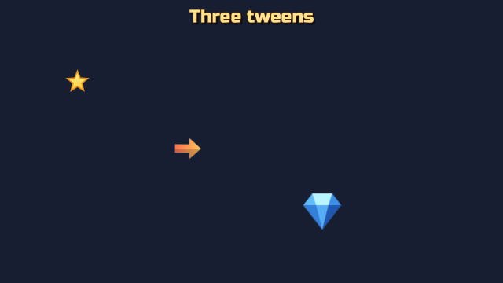
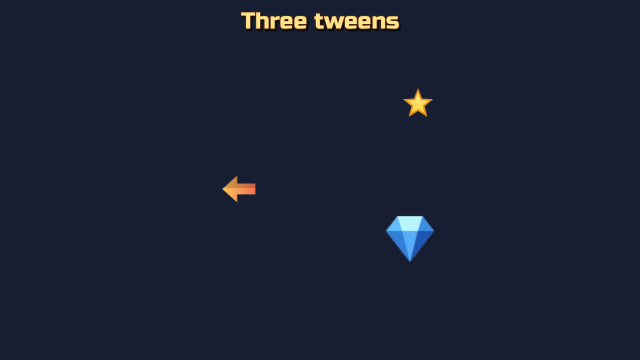

# A tween and a timeline

You will put three nodes on a scene and make them move, with no C++: one slides, one turns, one bobs after a short wait. You will change how they move by editing the file. Then you will see what runs underneath, and write a small sequence in C++ that fades a value in while it moves a point, waits, and calls back. Every block below is an excerpt of a real file: the example folder `docs/guide/examples/tween/`, or code that the build compiles and a test runs, so you can open the files next to this page.

You need the build from [Run the demo](run-the-demo.md) and the habit of the overlay folder from [Your first scene](first-scene.md). The first half is data. The second half is C++ and needs only a reader; you type nothing into the engine.

## What a tween and a timeline are

A **tween** is a value that goes from A to B in some seconds along a curve. A node's x going from 160 to 800 in two seconds is one tween. The curve is the **ease**: `Linear` is a steady speed, `QuadInOut` starts and ends slowly, `BackInOut` pulls back a little before it goes and overshoots a little at the end. The engine has these curves: `Linear`, `QuadIn`, `QuadOut`, `QuadInOut`, `CubicIn`, `CubicOut`, `CubicInOut`, `SineIn`, `SineOut`, `SineInOut`, `BackIn`, `BackOut`, `BackInOut`, `BounceOut` and `ElasticOut` (the set of easings.net, which has pictures of each).

A **timeline** is several tweens, and pauses, and calls to your code, laid on one line of time: this one fades in for a quarter of a second while that one moves, then wait, then call me. It plays as one tween.

Both run on the **game's time**, not the clock on the wall. A paused game stands still, and so does a test that steps the clock by hand. One slow frame does not skip an effect either: the frame time is cut to a quarter of a second at most, so a long stall does not finish everything at once.

## Move a node without C++

The demo has one component that plays a tween from data, `DemoTweenComponent`. It is in the demo, not in the engine's own components, so a game of your own that wants it writes a component like it (the second half of this page shows how). It moves its node from where the node is to that place plus an offset and a turn, and then back, for ever.

Copy the example into a folder of your own and give that folder to the demo:

<!-- command -->
```bash
mkdir -p $HOME/bagi-tween
cp -r docs/guide/examples/tween/config $HOME/bagi-tween/
build/macos-debug/bin/BagiDemo --content-overlay=$HOME/bagi-tween
```



(The pictures of this page are taken with `python3 tools/docs/guide_shots.py --only tween-start,tween-far`. This one is the fifth frame.) The star has just left its place, the arrow has turned a fraction of a degree, and the gem has not started: it waits.



Two seconds after the start the star is at the far end of its way, the arrow has turned half way round, and the gem is on its way back. Then the star goes back, and so on: there and back, for ever.

The three movers are three nodes of `docs/guide/examples/tween/config/SceneConfig.xml`. Each has a transform, a sprite and a `DemoTweenComponent`:

<!-- source: docs/guide/examples/tween/config/SceneConfig.xml -->
```xml
<node name="Slider">
  <components>
    <component type="TransformComponent" x="160" y="170" width="72" height="72" />
    <component type="SpriteRendererComponent" spriteId="DemoStar" />
    <component type="DemoTweenComponent" offsetX="640" duration="2" ease="QuadInOut" />
  </components>
</node>
<node name="Turner">
  <components>
    <component type="TransformComponent" x="440" y="340" width="76" height="76" />
    <component type="SpriteRendererComponent" spriteId="DemoArrow" />
    <component type="DemoTweenComponent" turn="180" duration="2" />
  </components>
</node>
<node name="Bobber">
  <components>
    <component type="TransformComponent" x="760" y="480" width="120" height="112" />
    <component type="SpriteRendererComponent" spriteId="DemoGem" fit="Contain" />
    <component type="DemoTweenComponent" offsetY="-120" duration="1" delay="0.5" ease="BackInOut" />
  </components>
</node>
```

From `docs/guide/examples/tween/config/SceneConfig.xml`. The fields of the component are these, and the scene units are the ones of the first scene (the view is 1280 by 720):

- `offsetX` and `offsetY`: how far the node goes at the far end, to the right and down. The slider goes 640 to the right, so its far end is x = 800. The bobber goes 120 up (a negative number), so from y = 480 to y = 360.
- `turn`: the turn at the far end, in degrees clockwise. The arrow turns 180, so it points left at the far end. A field you leave out is zero.
- `duration`: the seconds of one way. The way back takes as long.
- `delay`: the seconds before the first move of a run. The bobber waits half a second and then moves.
- `ease`: the curve of one way.

The editor shows the same fields. Open the demo with `--editor`, select a node with this component, and the inspector has a row for each field, with the same limits and a hint on hover. Where those rows come from is the subject of [Config and reflection](config-and-reflection.md).

## Change how they move

Open `$HOME/bagi-tween/config/SceneConfig.xml` and change the slider: `duration="1"` and `ease="BackInOut"`. Run the demo again. The star now first steps back a little to the left of where it started, then flies to the right, goes past the far end and settles back to it, and returns the same way, twice as fast as before. Put `ease="QuadInOut"` and `duration="2"` back and add `delay="1"`: the star stands still for a second and then moves as before.

Two things to know when you edit:

- **A run starts over when a field changes**, and starts from the node's own place, so a change shows from its first moment.
- **A node you move by hand while it moves keeps your move.** The component writes only the change it made itself: drag the star in the editor, and it carries on around the new place. The rule is in `tools/demo/CLAUDE.md` ("The two components"), with its one limit: save while a tween runs and the file gets the pose of that moment.

The demo's own scene has a toggle, `Animate`, that stops all its tweens. It belongs to the demo's panel; the example has no panel, so its tweens always run.

## What runs underneath

Every tween of the game is held by one service, `CoreManager::GetTweens()`, a `TweenManager`. The game loop calls its `Advance` once a frame with the frame time, before the scene updates, so a value is set before the logic of that frame reads it.

`DemoTweenComponent` is a small example of using it. When it has to start a run, it builds a timeline of one tween, from 0 to 1, tells it to go there and back for ever, and plays it:

<!-- source: tools/demo/src/Demo/Components/DemoTweenComponent.cpp -->
```cpp
void DemoTweenComponent::Start(const Settings& settings) {
    _running = settings;
    _progress = 0.0f;
    Timeline there;
    there.Append<float>(0.0f, 1.0f, {.duration = settings.duration, .ease = settings.ease}, [progress = &_progress](const float& value) { *progress = value; }).Yoyo().RepeatForever();
    _tween.Reset(CoreManager::GetTweens().Play(std::move(there), settings.delay));
}
```

From `tools/demo/src/Demo/Components/DemoTweenComponent.cpp`. Read it from the inside out:

- `Append<float>(0.0f, 1.0f, ...)` is one tween: a float from 0 to 1 over `duration` seconds along `ease`. The last argument is the **setter**, called every frame with the current value. Here it writes into a member, and the component's update turns that progress into a move of the node.
- `Yoyo()` makes every second pass the same way backwards, and `RepeatForever()` never stops. That is the there-and-back.
- `Play` hands the timeline to the manager, with the delay, and returns a handle to the run.

The handle goes into `_tween`, a `ScopedTween`. The setter above holds a pointer to `_progress`, a member of the component. If the component were destroyed while the tween ran, the next frame would write into freed memory. A `ScopedTween` is the owner that prevents it: its destructor cancels the tween, and a new `Reset` cancels the one before. Keep one as a member of whatever owns the tween. The class of the component says the rest in the fields it keeps:

<!-- source: tools/demo/src/Demo/Components/DemoTweenComponent.h -->
```cpp
class DemoTweenComponent : public IComponent {
    BE_CLASS(DemoTweenComponent, ICON = move)
public:
...
    BE_REFLECT_FIELD BE_FIELD_ATTRS(range(-1280, 1280), tooltip("How far to the right the far end is, in scene units")) float _offsetX = 0.0f;
...
    BE_REFLECT_FIELD BE_FIELD_ATTRS(tooltip("The curve of one way")) EaseType _ease = EaseType::SineInOut;
...
    ScopedTween _tween;      // after _progress: its setter points there
};
```

From `tools/demo/src/Demo/Components/DemoTweenComponent.h`. The `BE_REFLECT_FIELD` lines are what put the fields in the XML and in the inspector. A tween that runs from data like this one is the only one the engine ships: for anything beyond one value there and back, a game writes its own component, as the next part does.

## A sequence in C++

A timeline is more than one tween. Here is a class that makes something appear: a value fades from 0 to 1 while a point moves, then the timeline waits a moment, calls a function, and the whole run tells its owner it is done. The code is in `tests/BECore/GuideTweenExampleTest.cpp`, built with the engine's tests and run by them, so a change of the calls that breaks it fails a test and not a reader:

<!-- source: tests/BECore/GuideTweenExampleTest.cpp -->
```cpp
void Play(Vec2 startPos, Vec2 endPos) {
    Timeline timeline;
    timeline
        .Append<float>(0.0f, 1.0f, {.duration = 0.25f, .ease = EaseType::QuadOut}, [this](const float& alpha) { _alpha = alpha; })  // 0.0 .. 0.25
        .Join<Vec2>(startPos, endPos, {.duration = 0.25f}, [this](const Vec2& position) { _position = position; })                  // beside the one above
        .AppendDelay(0.125f)                                                                                                        // 0.25 .. 0.375
        .AppendCallback([this] { ++_pings; });                                                                                      // at 0.375
    _play.Reset(_tweens.Play(std::move(timeline), 0.0f, [this] { _onDone(); }));
}
...
    ScopedTween _play;  // the setters point at this object: the destructor cancels them
```

From `tests/BECore/GuideTweenExampleTest.cpp`; `_tweens` is `CoreManager::GetTweens()` in a game, and the test gives its own manager. What each call does with time:

- `Append` puts a tween after everything so far. The first one runs from 0 to 0.25 seconds.
- `Join` puts a tween at the start of the last one added, so it runs beside it: the point moves during the same quarter of a second as the fade.
- `AppendDelay` is a pause that calls nothing. It moves the next clip, and the end, later: here the end is at 0.375.
- `AppendCallback` calls your function once, when the time reaches it. If a frame jumps over it, it is still called, once.
- The `onComplete` of `Play` runs after the last clip, once. A cancel does not run it.

Why one timeline and not a tween whose `onComplete` starts the next one? A tween started inside a callback is first advanced by the **next** frame, and the time left over after the first one ended is dropped. A chain of four therefore costs up to four frames of lateness and drifts. A timeline works out every clip from the time since its start, so the pause between clips is exact and a big frame leaves every value right. (Rule 2 and 11 of `src/Modules/BECore/Animation/CLAUDE.md`.)

Three more things in a line each. A tween that repeats from its start, a spinner, is `Loop` of the manager, not a restart from `onComplete`. A cancel, from `ScopedTween` or by hand, leaves the value where it was and does not set the target: if the owner must end at the target, set it yourself or let the tween finish (rule 6). A timeline that never ends, like the yoyo above, runs until its owner cancels it (rules 16 and 17).

A coroutine can wait for a tween or a timeline too, with `co_await AwaitTween(handle)`, on the main thread only. It is not used on this page; the `How to use` of `src/Modules/BECore/Animation/CLAUDE.md` has the example and its one trap.

## How to test it

The test drives a manager by hand, so it needs no window and no wall clock. It uses times that are powers of two (an eighth, a quarter), so the sums are exact in floating point and a test can say `==`:

<!-- source: tests/BECore/GuideTweenExampleTest.cpp -->
```cpp
f.tweens.Advance(kQuarter);
EXPECT_EQ(f.appear.GetPings(), 0);

f.tweens.Advance(kEighth);
EXPECT_EQ(f.appear.GetPings(), 1);
EXPECT_EQ(f.done, 1);
```

From `tests/BECore/GuideTweenExampleTest.cpp`. At a quarter of a second the callback has not fired; an eighth later, at 0.375, it has fired once and the completion has run. The same file checks the values at 0.125 and 0.25 seconds, that a big frame leaves everything at its target, and that a stopped or destroyed owner is not written to.

A game that runs can be stepped the same way over the control API. This script starts the demo on your copy with the manual clock, steps it and reads the slider's x at one, two and three seconds of game time:

<!-- illustration: a script that exists in no file; it is the Python session of tools/control (the control API calls step and scene_get) -->
```python
import os
import sys

sys.path.insert(0, "tools/control")
from bagi_session import GameSession

session = GameSession()
try:
    session.launch(exe="build/macos-debug/bin/BagiDemo", content_overlay=os.path.expanduser("~/bagi-tween"))
    session.step(1, 0.0625)  # the first frame starts the runs
    for second in (1, 2, 3):
        session.step(16, 0.0625)  # one second of game time
        reply = session.call("scene_get", {"node": "Slider", "component": "TransformComponent", "path": "x"})
        print(second, reply["value"])
finally:
    session.close()
```

Run it from the root of the repository with `python3`, with the example unchanged in your copy. It prints:

<!-- illustration: what the script prints; the slider at the middle of its way, at the far end, and on its way back at the middle again -->
```text
1 480.0
2 800.0
3 480.0
```

The slider is half way at one second (480 is 160 plus half of 640), at the far end at two, and half way back at three. The same stepping makes the two pictures above.

## What you did

You put three nodes on a scene, gave each a `DemoTweenComponent`, and saw them slide, turn and bob after a wait. You changed the curve, the time and the delay by editing the file, saw that a node you move by hand keeps your move, and read the one function that starts a run. Then you read a timeline in C++, a fade and a move together, a pause and a call, and why it is better than a chain of callbacks.

Next: [Config and reflection](config-and-reflection.md), how a class and its fields reach the XML, the inspector and the control API.
