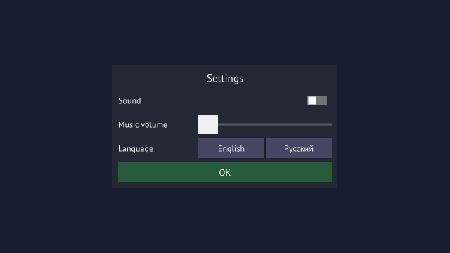
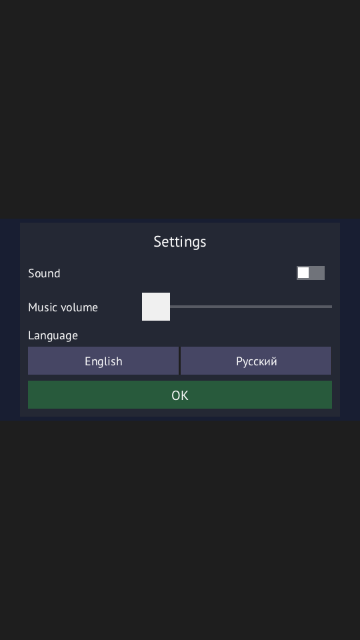

# A UI screen

You will take a small settings screen, a title, a toggle, a slider, a choice of language and an OK button, and change it four ways: a different canvas size, other words, other colours and a window shaped like a phone. You will see the engine check the screen on the sizes you ask for and tell you which control is too small to touch. Every block below is an excerpt of the example folder `docs/guide/examples/ui-screen/`, so you can open its files next to this page.

You need the build from [Run the demo](run-the-demo.md) and the habit of the overlay folder from [Your first scene](first-scene.md). No C++ is written here: a screen is data, and the part of the game that answers its buttons is game code (the page says where).

## Which way a screen is written

The engine has one in-game UI, and it is its own: a **canvas** (`UICanvasComponent`) on a node holds a tree of elements, and the engine lays the tree out for the window it is in. The same tree can be written three ways:

- as XML, in the scene file or in a `.ui.xml` file. The demo's `Panel` node is written this way;
- as HTML and CSS, in a `.ui.html` file with style sheets beside it. A compiler turns it into the XML of the same tree before anything else happens. This page uses this form, because designers and coding models already know the notation;
- as an RmlUi document, in a separate library with its own layout. It is off by default and meant for a screen that needs scrolling, text input or animation.

The first two are the default. The reason is the checks. The engine's own tools (the validator, the control API call `ui_tree` with its `issues`, `set_window`, the overlays of the editor) read the element tree, so they see a screen written as XML or as HTML and CSS. They cannot look into an RmlUi document. Choose RmlUi when you need what the tree does not have; this page does not use it. The reasons and the numbers behind the choice are in `src/Modules/BECore/UI/AuthoringDecision.md`.

## Copy the example and run it

The example is a folder laid out like a game's content. Copy it into a folder of your own and give that folder to the demo, as you did in the first scene:

<!-- command -->
```bash
mkdir -p $HOME/bagi-ui-screen
cp -r docs/guide/examples/ui-screen/config docs/guide/examples/ui-screen/assets $HOME/bagi-ui-screen/
build/macos-debug/bin/BagiDemo --content-overlay=$HOME/bagi-ui-screen
```

The folder holds a scene (`SceneConfig.xml` in `config/`), the screen (`settings.ui.html` and `settings.css`, in `assets`), the words (`UIStrings.xml`) and the colours (`UIThemes.xml`, both in `config/`). Run the third line again after each change below.



(The picture is taken with `python3 tools/docs/guide_shots.py --only ui-screen`, in a 1280 by 720 window. Your window may have another size; the screen is laid out for it.)

## The canvas in the scene

The scene has two nodes: a `Sky` quad like the one of the first scene, and a node `Settings` that carries the canvas:

<!-- source: docs/guide/examples/ui-screen/config/SceneConfig.xml -->
```xml
<node name="Settings" layer="10">
  <components>
    <component type="UICanvasComponent" source="assets/ui/settings.ui.html" space="Screen" scaleMode="ScaleWithScreen" referenceWidth="1280" referenceHeight="720" match="0.5" minScale="0.7" useSafeArea="true" />
  </components>
</node>
```

From `docs/guide/examples/ui-screen/config/SceneConfig.xml`.

- `layer="10"` draws the node above the sky, as in the first scene.
- `source` is the screen file. Without it the canvas would list its elements right here in the scene file, as the demo's `Panel` does.
- `space` says what the canvas fills. `Screen` fills the whole window, whatever the shape of the window. `SceneView` fills the scene's own view (the 1280 by 720 of `viewWidth` and `viewHeight`), fitted into the window, so it scales together with the scene: the demo's `Panel` is one, which is why it follows the editor's viewport. A settings screen on a phone wants to use the whole window, so this one is `Screen`.
- `scaleMode="ScaleWithScreen"` with `referenceWidth`, `referenceHeight` and `match` sizes the canvas against a design window of 1280 by 720: the screen is scaled by how much the real window is larger or smaller than that, width and height counted equally (`match="0.5"`).
- `useSafeArea="true"` keeps the content out of the notch of a phone and the other cut-outs of its screen (the safe area).
- `minScale` is a floor for that scale. You will meet it again at the end.

## The screen file

The screen is HTML. The part with the toggle, the slider and the language choice:

<!-- source: docs/guide/examples/ui-screen/assets/ui/settings.ui.html -->
```html
<link rel="stylesheet" href="settings.css">
<div id="Plate">
  <span id="Title">{#settings.title}</span>
  <div id="Sound" data-widget="toggle" data-bind="soundOn" data-action="SettingsSound">{#settings.sound}</div>
  <div id="MusicRow" class="row centered">
    <span id="MusicCaption" class="caption">{#settings.music}</span>
    <div id="Volume" data-widget="slider" data-bind="volume" data-action="SettingsVolume" data-min="0" data-max="1" data-step="0.1"></div>
  </div>
...
      <button id="LanguageEn" data-action="SettingsLanguage" data-value="en">{#lang.en}</button>
      <button id="LanguageRu" data-action="SettingsLanguage" data-value="ru">{#lang.ru}</button>
...
  <button id="Ok" data-action="SettingsClose">{#settings.ok}</button>
</div>
```

From `docs/guide/examples/ui-screen/assets/ui/settings.ui.html`.

- `id` is the name of the element. The engine's tools, the editor and your game code find an element by it, so give every element you care about an `id`.
- `data-widget` makes a control of a plain `div`: `toggle` is a row with a caption and a switch, `slider` a draggable bar. A `button` is a button.
- `data-action` is the name of what happens when the control is used. The screen does not do it; the game listens for the name (see the next section).
- `data-bind` names a **variable** that the control shows. The game sets the variable, and the control follows it.
- `{#settings.title}` is a word from the string table (see Words below).

The style sheet is CSS with a few engine words. The rules for the plate, the buttons and the portrait window:

<!-- source: docs/guide/examples/ui-screen/assets/ui/settings.css -->
```css
#Plate    { anchor: center; display: flex; flex-direction: column; align-items: stretch; gap: 12px; padding: 16px; width: 94%; max-width: 640px; height: 348px; background: var(--plate); }
...
.group    { display: flex; flex-direction: row; gap: 4px; flex: 1; height: 56px; background: rgb(30, 30, 30); }
.group button { flex: 1; height: 56px; font-size: 24px; background: rgb(70, 70, 100); }
#Ok       { height: 56px; font-size: 26px; background: var(--ok); }
@media (orientation: portrait) {
  #Plate           { height: 388px; }
  #LanguageRow     { flex-direction: column; height: 96px; }
  #LanguageCaption { height: 32px; }
}
```

From `docs/guide/examples/ui-screen/assets/ui/settings.css`.

- `display: flex`, `gap`, `padding`, `flex: 1` and `align-items` lay the children out in a row or a column, as in a browser. Sizes are in pixels of the canvas, that is of the 1280 by 720 design window, and in percent; `width: 94%` with `max-width: 640px` is a plate that is nearly the width of a phone and no wider than 640 units on a desktop.
- `anchor: center` is **not CSS**. It is the engine's own property: where in its parent the element sits (`center`, `top-left`, `stretch` and the others). It is spelled like a CSS property because that is the notation the file is in.
- `background` is the colour of the element, `var(--plate)` a colour from the themes (see Colours below).
- `@media (orientation: portrait)` is a **variant**: when the canvas is taller than wide, those rules win. Here the plate gets a little taller, and the Language row puts its caption above the buttons, because side by side they would not fit a narrow window:



(The dark band in the middle is the sky of the scene, whose view is 16 by 9 and keeps its shape in the window. The screen is not tied to that view: its canvas is `Screen`.)

Anything the subset does not understand is reported, never dropped silently; the last section shows one. The list of what it understands is `.claude/rules/ui-web.md`.

### What it becomes

A screen in HTML and CSS is compiled to the same tree that XML spells. You can see it in the control API: the toggle `Sound` has two children, `SoundCaption` and `SoundSwitch`. The demo's `Panel` has a toggle written as XML, and it is made of the same parts:

<!-- source: tools/demo/config/SceneConfig.xml -->
```xml
<element type="UIElement" name="Animate" height="56" layout="Stack" direction="Horizontal" padding="12,6,12,6" spacing="8" crossAlign="Center" color="58,74,118,255" cornerRadius="10">
  <components>
    <component type="UIInputClicker" />
    <component type="UIToggleComponent" bind="demoAnimate" action="DemoAnimate" />
  </components>
  <children>
    <element type="UIElement" name="AnimateCaption" flex="1" height="100%" fontSize="22">
      <components>
        <component type="UITextComponent" text="Animate" verticalAlign="Center" wrap="false" />
      </components>
    </element>
    <element type="UIElement" name="AnimateSwitch" height="100%" aspectRatio="1.25">
      <components>
        <component type="UISwitchComponent" partShape="Round" />
      </components>
    </element>
  </children>
</element>
```

From `tools/demo/config/SceneConfig.xml`. The `data-bind` is its `bind`, the `data-action` its `action`, the HTML's caption is the `UITextComponent` of the caption child. So a rule about one form holds for the other.

## A control owns no state

Click the toggle with the mouse and nothing seems to happen: the switch does not move. That is on purpose. A control only reports the action; **the game decides** what the answer is and sets the variable that the control is bound to. Then the control follows the variable. So a screen cannot disagree with the game.

You can see it over the control API. This script starts the demo with your folder and clicks `Sound` the way a player would:

<!-- illustration: a script that exists in no file; it is the Python session of tools/control (the control API calls ui_click and ui_tree) -->
```python
import os
import sys

sys.path.insert(0, "tools/control")
from bagi_session import GameSession

session = GameSession()
session.launch(exe="build/macos-debug/bin/BagiDemo", content_overlay=os.path.expanduser("~/bagi-ui-screen"))
session.step(3)
print(session.call("ui_click", {"name": "Sound"}))
session.step(3)


def find(element, name):
    if element.get("name") == name:
        return element
    for child in element.get("children", []):
        if (found := find(child, name)) is not None:
            return found


canvas = next(c for c in session.call("ui_tree")["canvases"] if c["node"] == "Settings")
print("checked:", find(canvas["elements"][0], "Sound")["checked"])
session.close()
```

Save it as a file and run it from the root of the repository with `python3`. It prints:

<!-- illustration: the two lines the script prints; the x and y are the middle of the toggle at the default window size -->
```text
{'action': 'SettingsSound', 'canvas': 'Settings', 'clicked': 'Sound', 'consumed': True, 'takenBy': 'element', 'value': 'true', 'x': 960.0, 'y': 429.0}
checked: False
```

The click was taken by the element and it answered with the action name, `SettingsSound`, and a value. The toggle is still unchecked after the frames that followed, because no game code answered it. The demo's own panel does: `DemoControlsComponent` listens for the action of its toggle and sets the variable (`tools/demo/CLAUDE.md`). A screen of your game gets such a component of your game. It is C++ and is not on this page.

## Words

Every text on the screen is a `{#key}`. The table of words is a file of the game:

<!-- source: docs/guide/examples/ui-screen/config/UIStrings.xml -->
```xml
<UIStrings default="en">
  <language id="en">
    <string key="settings.title" text="Settings"/>
    <string key="settings.sound" text="Sound"/>
    <string key="settings.music" text="Music volume"/>
    <string key="settings.language" text="Language"/>
    <string key="settings.ok" text="OK"/>
    <string key="lang.en" text="English"/>
    <string key="lang.ru" text="Русский"/>
  </language>
...
</UIStrings>
```

From `docs/guide/examples/ui-screen/config/UIStrings.xml`. The file has a second `language`, `ru`, with the same keys. `default` is the language the screen starts in, and the one it falls back to for a key that another language lacks. The names of the languages are written in themselves in both, so a player who has the wrong language on can still find the right button.

In your copy, change `default="en"` to `default="ru"` and run: the title is `Настройки`, the sound is `Звук`, OK is `Готово`. A game changes the language while it runs (`UIStrings::SetLanguage`, which the language buttons ask for with their action `SettingsLanguage`); the file only decides where it starts. Nothing in this example answers `SettingsLanguage`, so its two language buttons do nothing here.

A key that no language has is shown as the key, and the engine says so. Change `{#settings.ok}` in `settings.ui.html` to `{#settings.okay}` and run: the button reads `settings.okay`, and the log has

<!-- illustration: the warning for a missing string; the time of day is whenever you run it -->
```text
[Warning] [12:00:00.000] UIText: no string 'settings.okay' in the language 'en' or the default one
```

Put the key back before the next step.

## Colours

The plate and the OK button take their colours by name, `var(--plate)` and `var(--ok)`, not as numbers. The names are **tokens** of a theme table, a second file of the game:

<!-- source: docs/guide/examples/ui-screen/config/UIThemes.xml -->
```xml
<UIThemes default="night">
  <theme id="night">
    <color name="plate" value="36,40,52,255"/>
    <color name="ok" value="40,90,60,255"/>
  </theme>
  <theme id="day">
    <color name="plate" value="62,92,140,255"/>
    <color name="ok" value="46,125,80,255"/>
  </theme>
</UIThemes>
```

From `docs/guide/examples/ui-screen/config/UIThemes.xml`. Change `default="night"` to `default="day"` and run: the plate is a blue (it was dark grey) and the OK button a brighter green. The sky behind them does not change, because it is a quad of the scene and not a colour of the theme. A game switches themes while it runs, as it switches languages.

## Is it right on a phone

A window the shape of a phone is the test a desktop screen fails first. You do not need a phone: a headless game has a window the control API can resize, with a density and a notch. The example folder has a script that does it for four windows and asks the engine for what its validator found:

<!-- command -->
```bash
python3 docs/guide/examples/ui-screen/sizes.py $HOME/bagi-ui-screen
```

Without the folder it checks the example itself. It starts `BagiDemo` with a copy of the folder (the game writes into its content folder, so the copy keeps yours), sets each size with `set_window`, steps a frame and reads `ui_tree`. It prints:

<!-- illustration: the output of the script on the unchanged example; the scale and the issues are what the engine's validator reports -->
```text
desktop          1280x720 @1  scale 1.00  issues: none
phone, notch     390x844 @3  scale 1.79  issues: none
phone, sideways  844x390 @3  scale 1.79  issues: none
small phone      320x480 @2  scale 0.82  issues: TouchTargetTooSmall Sound, TouchTargetTooSmall Volume, TouchTargetTooSmall LanguageEn, TouchTargetTooSmall LanguageRu, TouchTargetTooSmall Ok
```

`@3` is the pixel density: a phone of 390 by 844 points has three pixels to a point. `scale` is how much the engine enlarged the screen to fit. `issues` are the findings of the validator for the canvas, and the first three windows have none.

The last one has a finding that is worth reading. `TouchTargetTooSmall` says that a control a finger must press is smaller than the engine's minimum touch size, **as the player sees it**: its smaller side times the scale, divided by the density of the screen (`.claude/rules/ui-layout.md`, "Validator and the size matrix"). The controls are 56 units high, the scale is 0.82 and the density is 2: 56 x 0.82 / 2 is about 23, and the minimum is 32 (`minTouchSize` of the engine's `config/UIConfig.xml`). On a small phone of a high density the controls are too small to hit.

This is what `minScale` is for. It is a floor under the scale: below it the engine does not shrink the screen. In the example it is 0.7, and the scale of this window (0.82) is already above it, so it does not help here. A higher floor does. In your copy, change `minScale="0.7"` to `minScale="1.2"` in `config/SceneConfig.xml` and run the script again:

<!-- illustration: the output with minScale 1.2 in the copy -->
```text
desktop          1280x720 @1  scale 1.20  issues: none
phone, notch     390x844 @3  scale 1.79  issues: none
phone, sideways  844x390 @3  scale 1.79  issues: none
small phone      320x480 @2  scale 1.20  issues: none
```

The small phone is clean, at a price you can read in the first line: the floor holds for every window, so the desktop screen is 1.2 times larger than its design as well. A smaller floor between the two is a choice you make for your game. Put `0.7` back when you want to go on with the example.

A game keeps this check in a test, so that a change that breaks a size fails `ctest` and not a player. The example has one: `GuideExamplesTest` (`tests/BECore/GuideExamplesTest.cpp`) loads the folder and runs its canvas over the engine's size matrix, `ValidateOnMatrix` (ten shapes of window, with and without a notch, each scale mode), once for every language of the table; it also asks that no word is cut. The matrix is run at the user scale 1.0: this screen has a plate of a fixed height, and at the larger scale a user may set for reading, it does not fit a small window. A screen of your game decides what it promises.

The editor can show the same thing as a picture. Its viewport has a size picker with phone shapes and an `Overlays` menu that draws the touch targets and the validator's findings on the screen (`src/Modules/BECore/UI/CLAUDE.md`, "Editor preview"). It reads the same element tree as the validator.

## When you make a mistake

The screen file is checked like the scene was. In `settings.css`, in the rule of `#Ok`, add `justify-content: center;` (it is a CSS word the subset does not have) and run. The log has:

<!-- illustration: the warning the engine writes for a CSS property it does not support; the time of day is whenever you run it, line 10 is the line of the rule in settings.css -->
```text
[Warning] [12:00:00.000] UIWebDocumentLoader: 'assets/ui/settings.ui.html' css:settings.css line 10: property 'justify-content' is not supported
```

The line names the screen, the style sheet, the line in it and the property. The button still shows; the engine skipped the property it did not know. `GuideExamplesTest` has the same rule: the example compiles with an empty report, so a property of that kind in the example would fail `ctest`.

## What you did

You ran a screen of the engine's own canvas, written in HTML and CSS, from a folder of content: the same tree the XML spells, which is why the tools can read and check it. You saw that a control reports an action and the game answers it, changed the words and the colours of the screen by changing two files, and asked the engine whether it fits a phone, a notch and a high density, and why one size does not.

Next: [A prefab and its overrides](prefab.md), a scene node written once and used many times with changes of its own.
